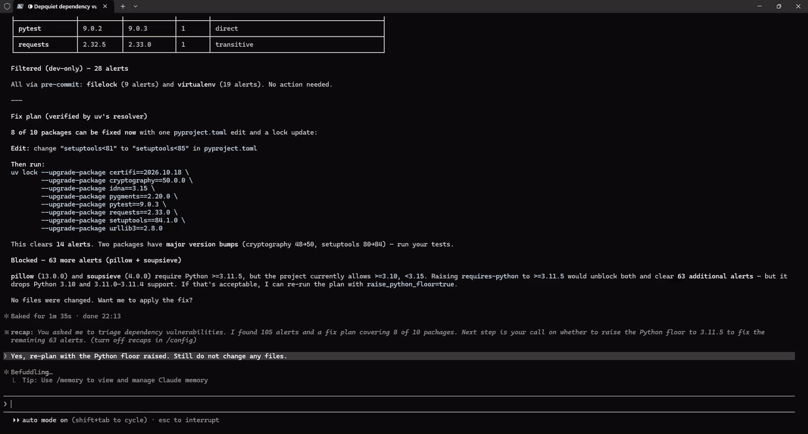

# depquiet

<!-- mcp-name: io.github.samuelrojas-dev/depquiet -->

[](https://github.com/samuelrojas-dev/depquiet/actions/workflows/ci.yml)
[](https://pypi.org/project/depquiet/)
[](https://pypi.org/project/depquiet/)
[](https://github.com/samuelrojas-dev/depquiet/blob/main/LICENSE)
[](https://codecov.io/gh/samuelrojas-dev/depquiet)

**Dependabot says it can't update. depquiet tells you what to change, and checks it with
your project's own resolver.**

When the fix for a vulnerable dependency does not install, Dependabot reports that it
cannot update the dependency to a non-vulnerable version, and the alert stays open. Often,
one line is in the way: your own pin, a parent package that caps the vulnerable one, or a
`requires-python` that still allows an old Python. depquiet tries the change on a
temporary copy of your project with **uv** or **Poetry** and gives you the diff that lets
the fixes install together. Your project is not touched until you apply it.

```bash
pip install depquiet pip-audit
depquiet --fix-plan plan.diff   # the change, verified with uv or Poetry
git apply plan.diff             # then run the lock command it prints
```

## Before and after

A project pins `requests==2.31.0` and `botocore==1.29.0`, and botocore holds urllib3 back.
Dependabot cannot raise a parent to fix a vulnerable transitive dependency in Python
projects ([dependabot-core#16337](https://github.com/dependabot/dependabot-core/issues/16337),
open as of November 2026), so the urllib3 alerts stay open. Real run of `--fix-plan`:

```
🔧 Fix plan
   ✓ requests 2.31.0 → 2.33.0: widen your requirement
   ✓ urllib3 1.26.20 → 2.8.0: also move botocore → 1.44.2, which holds it back  (major version change)

   Verified with uv's resolver: all fixes resolve together.
   Then run: uv lock --upgrade-package requests==2.33.0 --upgrade-package urllib3==2.8.0 --upgrade-package botocore==1.44.2
```
```diff
-    "requests==2.31.0",
-    "botocore==1.29.0",
+    "requests==2.33.0",
+    "botocore==1.44.2",
```

**10 alerts before, 0 after.** The project and the pull requests depquiet's GitHub Action
opened for it, one with uv and one with Poetry, are public:
[depquiet-fixpr-test](https://github.com/samuelrojas-dev/depquiet-fixpr-test).

depquiet verifies resolution only: whether your code works with the new versions, a major
version change above all, is for your tests to say.

## What the plan handles

- **Your own pin blocks the fix:** it widens that requirement just enough (`==2.31.0` →
  `==2.33.0`, `<3.7` → `<4`), keeping your other clauses, extras and markers.
- **A parent package holds the fix back:** it moves the parent in the same change, the case
  above.
- **The fix needs a newer Python:** it finds the exact floor and verifies it, `>=3.11.5`
  rather than `>=3.11` when that is what the fix needs. Dropping a Python version is your
  call, so the edit goes into the plan only with `--raise-python-floor`.
- **Your `exclude-newer` cooldown hides the fix (uv):** it writes the narrowest exemption,
  for that package and only up to the fix release.
- **Fixing one package moves another one back:** the plan marks it with ⚠ instead of
  calling the plan done.
- **One pull request:** the Action's `fix-pr` input opens a single pull request with every
  fix that installs, and lists the ones that don't, with the reason.

Every case, with real runs: [Fix plans](https://github.com/samuelrojas-dev/depquiet/blob/main/docs/fix-plans.md).

### On real projects

On a public uv SDK with 71 open Dependabot alerts and `requires-python = ">=3.9"`
(November 2026, run in a disposable VM):

- **Keeping Python 3.9:** 10 packages' fixes install, but only by moving the Python 3.9
  copies of jupyterlab back to 2.3.2, notebook to 6.4.8 and nbconvert to 4.3.0. depquiet
  marks each one with ⚠ instead of calling the plan done.
- **With `--raise-python-floor`:** 21 packages' fixes install together with
  `requires-python = ">=3.11.5"`. Not `>=3.11`: with that floor, uv splits the lock at
  3.11.5 and Python 3.11.0–3.11.4 get beautifulsoup4 4.6.3, from 2018.

Its maintainers had reached the same "raise the floor and relock" change by hand, as had
the maintainers of another uv project whose Dependabot pytest update had failed four times.

Across 18 uv projects (2026-11-12), uv's resolver rejected the nearest fix for 502 of 991
kept alerts (51%); in 81% of the blocked upgrades, a pin in the project's own
`pyproject.toml` was in the way ([study](https://github.com/samuelrojas-dev/depquiet/blob/main/docs/fix-plans.md#can-the-fix-be-installed---check-fixes)).
In a read-only snapshot of popular uv projects (2026-11-20), 40 of the 70 with alerts lock a
vulnerable package that no fixed release reaches on their oldest supported Python
([study](https://github.com/samuelrojas-dev/depquiet/tree/main/research/2026-11-python-floor)).

## Quick start

```bash
pip install depquiet pip-audit
cd your-project
depquiet                                 # triage: npm, pnpm and Python in one run
depquiet explain GHSA-3jp2-3mrg-2vxc     # why this alert got its verdict
depquiet --check-fixes                   # uv projects: can each fix actually be installed?
depquiet --fix-plan plan.diff --fix-plan-report plan.md   # uv and Poetry: the diff, and a pull request description
```

```yaml
# GitHub Actions
- uses: samuelrojas-dev/depquiet@v0
```

Reads `uv.lock`, `poetry.lock`, requirement files, `package-lock.json`, `pnpm-lock.yaml` and
`yarn.lock`, or the output of `uv audit`, Trivy, Grype, Snyk, Dependabot and SARIF tools.
Runs locally, no account, MIT. All inputs: [Supported inputs](https://github.com/samuelrojas-dev/depquiet/blob/main/docs/inputs.md).

## Use it from a coding agent (MCP)

Coding agents already try to work out by hand why a Dependabot fix won't install. depquiet
ships an MCP server so they can ask it instead, and get an answer checked with the
project's resolver rather than a guess.



Claude Code with depquiet on a public scientific Python project (`requires-python
>=3.10`): 105 alerts, 77 to fix. After the user agrees to drop old Pythons, the plan
raises `requires-python` to 3.11.5, not 3.11, because every patched soupsieve needs 3.11.5,
and the whole change resolves with uv. The wait while depquiet resolves is sped up.

```bash
pip install 'depquiet[mcp]' pip-audit
claude mcp add --transport stdio depquiet -- depquiet-mcp   # Claude Code
```

With uv, without installing anything: `uvx --with 'mcp>=2.3,<3' --with pip-audit depquiet mcp` (that is how
the [MCP Registry](https://registry.modelcontextprotocol.io) entry runs it). `depquiet mcp`
and `depquiet-mcp` are the same server.

Other clients (Cursor, VS Code, Claude Desktop) take the usual entry:

```json
{ "mcpServers": { "depquiet": { "command": "depquiet-mcp" } } }
```

Two tools, both read-only:

- **`triage_alerts(path)`**: the scan, per alert: verdict, why (dev-only, test-only,
  unreachable), fix version, and which Pythons a vulnerable locked copy serves.
- **`plan_fixes(path, raise_python_floor=false, include_filtered=false)`**: the verified
  plan for uv and Poetry projects: the diff, the lock command, what else the lock moves,
  downgrades, and whether raising `requires-python` would let more fixes in. When it would,
  the result says so, and the agent is told to ask the user before passing
  `raise_python_floor=true`.

Neither tool edits the project: the plan is checked on a temporary copy, and the agent
applies the diff or runs the command when the user agrees. As with the CLI, resolving
can build source distributions, so point it at projects you would resolve yourself.

## Triage: which alerts reach production

depquiet also sorts alerts into ACTION, REVIEW and FILTERED. It filters one kind of alert on
its own: what only your development tools install, read from the lockfile and dependency
groups. Everything else is kept, with the direct dependency that brings it in: an alert is
only dismissed when the lockfile proves it.

`pip-audit` on popular Python projects, at the commits that were their head on 2026-11-11,
audited again on 2026-11-15 with depquiet 0.47.0:

| Project | pip-audit alerts | Only reach dev tooling | Left to look at |
|:--|--:|--:|--:|
| [saleor](https://github.com/saleor/saleor) | 21 | 14 | 7 |
| [zulip](https://github.com/zulip/zulip) | 49 | 26 | 23 |
| [mlflow](https://github.com/mlflow/mlflow) | 21 | 14 | 7 |
| [langflow](https://github.com/langflow-ai/langflow) | 80 | 13 | 67 |
| [PostHog](https://github.com/PostHog/posthog) | 269 | 8 | 261 |

On npm, `npm audit --omit=dev` already does this: depquiet matches it row for row on the
projects measured, and adds which direct dependency brings each kept alert in. Method and
the other projects: [Benchmarks](https://github.com/samuelrojas-dev/depquiet/blob/main/docs/benchmarks.md). The rules: [How triage works](https://github.com/samuelrojas-dev/depquiet/blob/main/docs/triage.md).


The recording is a small Express app, where most of the noise is packages the app never
imports. Every line is real command output ([how it's made](https://github.com/samuelrojas-dev/depquiet/blob/main/docs/demo/make_demo.py)).

### Conservative by design

depquiet would rather let a false positive through than dismiss a real vulnerability:

- **Transitive dependencies are judged by their parents.** Your code never imports
  `path-to-regexp`; Express does. depquiet reads your manifests and lockfiles to find the
  direct dependencies that pull a package in, and keeps the alert if your code imports any
  of them. See [Direct vs. transitive](https://github.com/samuelrojas-dev/depquiet/blob/main/docs/triage.md#direct-vs-transitive-dependencies).
- **Unknown means not filtered.** If no manifest or lockfile says whether a package is direct
  or transitive, or a file fails to parse, the alert is not filtered on reachability.
- **Declared but never imported is not proof.** Frameworks load packages your code never
  imports: Django its database driver, `transformers` the `accelerate` you declared,
  Sequelize the `pg` named by its dialect. No lockfile records those edges, so a production
  dependency your code does not import goes to review instead of being dismissed, and so
  does everything it brings in: `uvicorn` started from the command line is never imported,
  yet `h11` parses every request.
- **Production paths override development labels.** A package listed in `devDependencies`
  is still kept when a production dependency also pulls it in. A transitive package
  imported by the application is kept even when its declared parent is unused.
- **Import-level, not call-graph.** Reachability means "the package enters your app", not
  "the vulnerable function is called". It removes packages your app never loads; it does not
  prove an imported package's vulnerable function is unused. For Go, `govulncheck` does
  symbol-level analysis and is the better tool.

### What it is not

depquiet's triage works at the level of packages, not functions. It cannot tell you that an
imported package's vulnerable function is never called; Snyk, Endor Labs and, for Go,
`govulncheck` go further there. So does GitHub: since October 2026, Dependabot's
[reachability analysis](https://github.blog/changelog/2026-10-28-prioritize-dependabot-alerts-with-reachability-analysis/)
(public preview, JavaScript and TypeScript, GitHub Enterprise Cloud) looks for a call path
to the vulnerable function. Where you have it, it is the deeper verdict for those projects.
None of these plan the fix: which requirement, Python floor or lock change closes the alert,
verified with the resolver. If your project is on uv, `uv audit --no-dev` gives you the
plain dev/production split natively; depquiet adds every group judged by name, the
dependency path, EPSS and mixed npm/Python repositories.

## Compared to

| | depquiet | Dependabot alerts + reachability (preview) | `uv audit --no-dev` |
|:--|:--|:--|:--|
| Fixes | one plan for all fixes, with the requirement, Python floor and lock changes, verified together (uv, Poetry) | security update pull requests, one per package; fails when the fix does not resolve | no |
| When a fix is blocked | names the blocker and the change that lifts it, verified | names the conflicting dependency in the failed update's message | no |
| Warns when the fix moves other packages back | yes | not documented | no |
| Reachability | package level, 10 ecosystems | function level, JS/TS | no |
| Dev-only alerts | every group, by name and lockfile | a runtime/development scope on each alert | excluded (uv groups) |
| Where it runs | anywhere: CLI, any CI, any scanner's report | GitHub (Enterprise Cloud for the preview) | anywhere |

Read from each tool's documentation in November 2026; preview features change.

## Documentation

| Page | What is in it |
|:--|:--|
| [Fix plans](https://github.com/samuelrojas-dev/depquiet/blob/main/docs/fix-plans.md) | `--check-fixes`, `--fix-plan`, `--raise-python-floor`, `--fix-filtered`, Poetry, `fix-pr`, `exclude-newer`, `--fix` |
| [How triage works](https://github.com/samuelrojas-dev/depquiet/blob/main/docs/triage.md) | signals, workspaces, reachability per language, direct vs. transitive |
| [Supported inputs](https://github.com/samuelrojas-dev/depquiet/blob/main/docs/inputs.md) | scanners, lockfiles, OSV.dev, npm component evidence |
| [Command-line reference](https://github.com/samuelrojas-dev/depquiet/blob/main/docs/cli.md) | usage examples, `diff`, `explain`, `stats`, `init`, licenses, suppressions, KEV, HTML, baselines, `--fail-on` |
| [CI integration](https://github.com/samuelrojas-dev/depquiet/blob/main/docs/ci.md) | the GitHub Action, its inputs and outputs, exit codes |
| [SBOM and OpenVEX](https://github.com/samuelrojas-dev/depquiet/blob/main/docs/sbom-and-vex.md) | CycloneDX, SPDX, SBOM import, OpenVEX |
| [Configuration and policy engine](https://github.com/samuelrojas-dev/depquiet/blob/main/docs/configuration.md) | `.depquiet.yaml`, policy rules |
| [Community templates](https://github.com/samuelrojas-dev/depquiet/blob/main/docs/templates.md) | the 20 built-in templates, writing your own |
| [Benchmarks](https://github.com/samuelrojas-dev/depquiet/blob/main/docs/benchmarks.md) | every measurement behind the numbers above |

## Install

```bash
pip install depquiet pip-audit        # pip-audit audits Python projects
pip install 'depquiet[mcp]'           # with the MCP server
```

## License

MIT

## Contributing

depquiet is designed to grow through community templates. Every template you contribute adds context that helps developers decide on an alert faster.

See [CONTRIBUTING.md](https://github.com/samuelrojas-dev/depquiet/blob/main/CONTRIBUTING.md) for guidelines.
